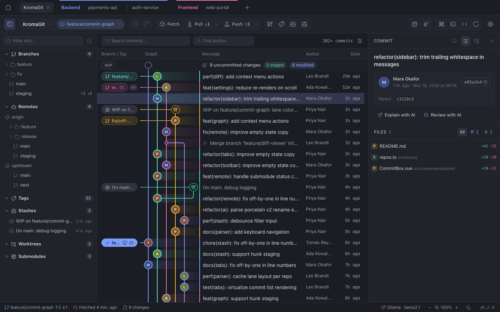
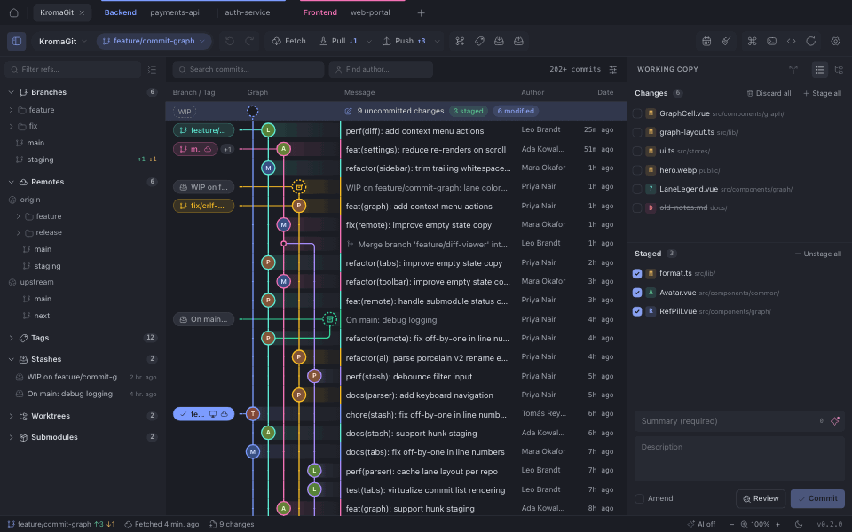
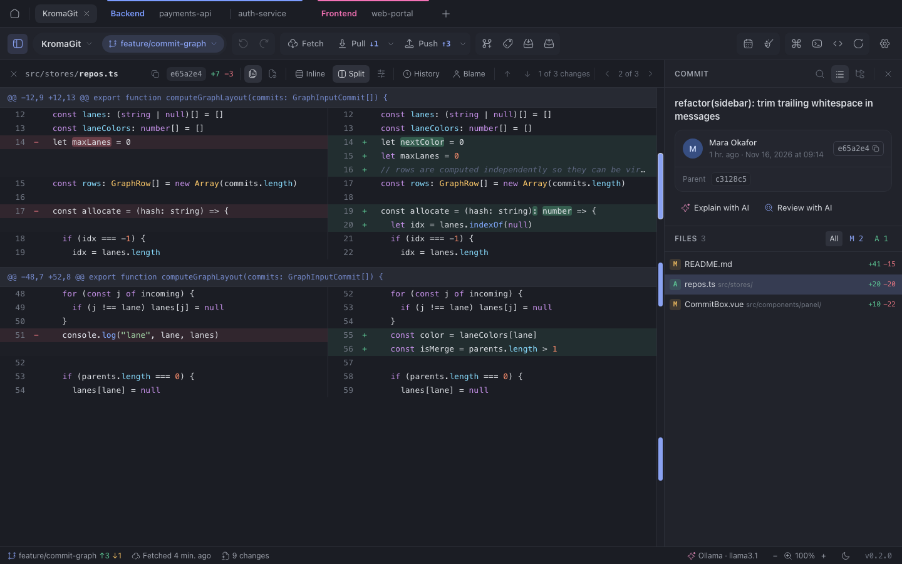
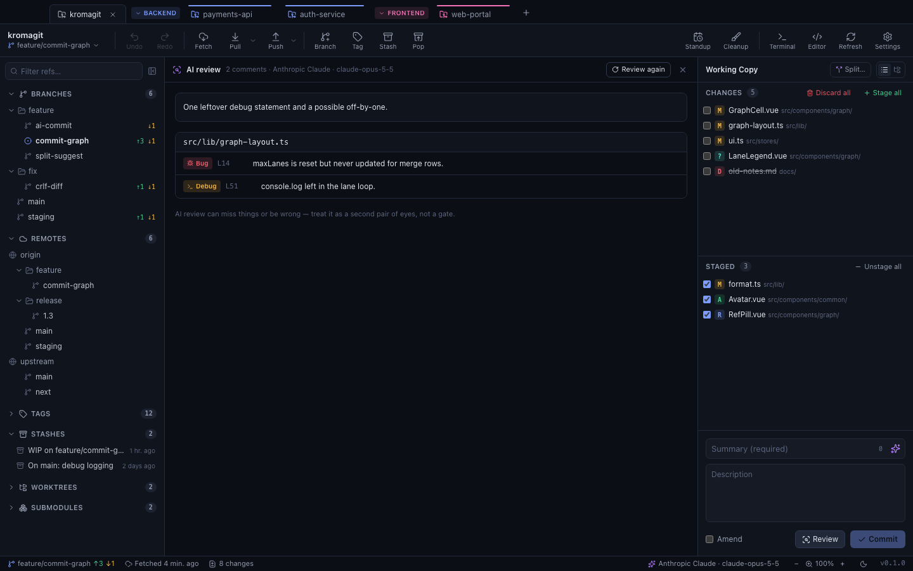
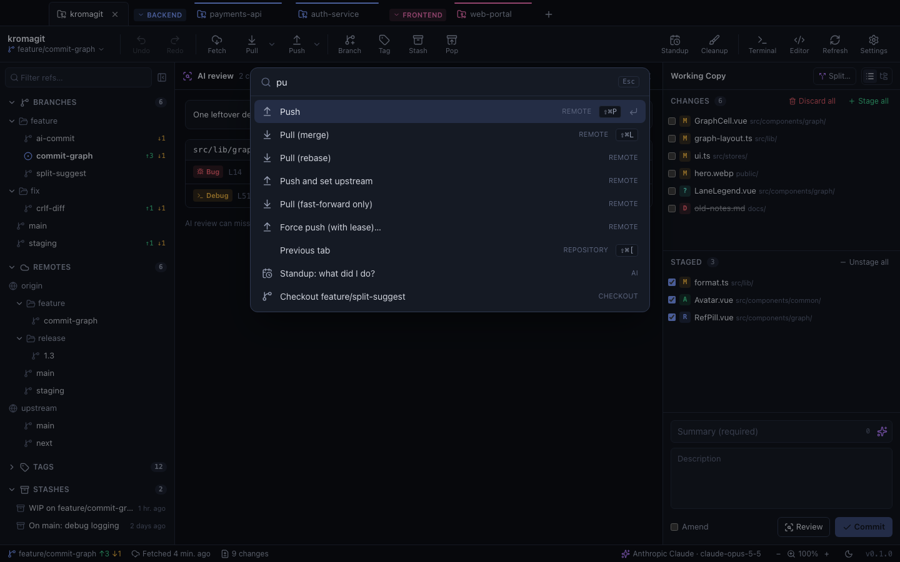
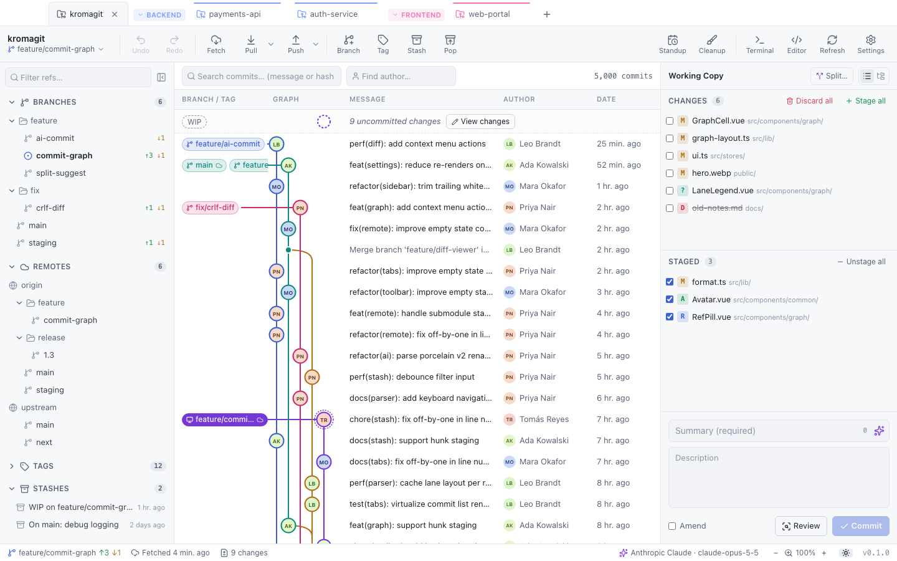
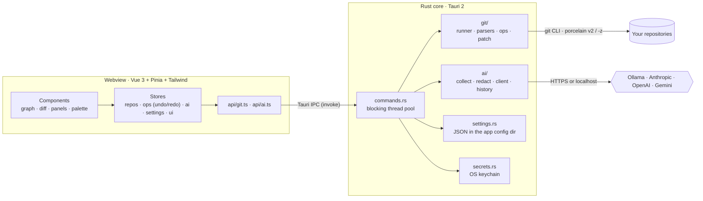

<p align="center">
  
</p>

<h1 align="center">KromaGit</h1>

<p align="center">
  A fast, local-first Git desktop client — with optional AI that runs on your machine or with your own API key.
</p>

<p align="center">
  <a href="https://github.com/cheakimhengg/KromaGit/actions/workflows/ci.yml"></a>
  <a href="LICENSE"></a>
  
  
</p>

<p align="center">
  
</p>

KromaGit runs entirely on your computer: no server, no account, no telemetry. It drives the `git` you already have installed, so it behaves exactly like the command line — just with a graph you can see and actions you can undo.

<p align="center">
  
</p>

## Features

**History**
- Commit graph with colored lanes, curved merges, author profile pictures and branch/tag pills
- Opens 50,000-commit repositories in well under a second; every list is virtualized
- Search by message or hash, filter by author, walk commits with ↑ / ↓; show or hide any column
- Commit details with full message, parents and changed files

**Changes**
- Stage / unstage whole files, single hunks or **selected lines**; discard just as precisely
- Unified and side-by-side diffs with syntax highlighting; before/after previews for images (PNG, JPEG, GIF, WebP, …)
- Commit, amend (pre-filled with the last message), per-repo message drafts

**Branches & remotes**
- Branch tree grouped by prefix (`feature/…`), ahead/behind counts, `[gone]` detection
- Checkout, create, rename, delete, merge, rebase, cherry-pick, revert, reset (soft/mixed/hard)
- Fetch, pull (merge / rebase / fast-forward), push (set upstream, force-with-lease), tags, stashes, worktrees, submodules
- Merge/rebase conflicts show a banner with **Continue** and **Abort**

**Safety**
- **Undo / redo** for almost every action — guarded so it refuses if the repository changed behind your back
- Confirmation before anything destructive; discard and `reset --hard` keep a hidden backup that Undo restores
- Network commands time out instead of hanging on a password prompt

**Workflow**
- Multiple repositories as tabs, with named, colored, collapsible **tab groups** and drag-to-reorder
- **⌘K command palette** for every action, branch and tab; **⌘P** to jump to any recent repository; a Home page; keyboard shortcuts throughout (⌘W closes the tab, Esc closes whatever is open)
- Five eye-friendly themes — Kroma Dark, Midnight, Dim, Kroma Light, Paper — or follow the system, with six accent colours; zoom, resizable panels, a welcome screen with recent repositories, open in your terminal or editor

**Profile pictures** are looked up by author email: GitHub no-reply addresses directly, other authors through the GitHub API (repositories hosted on GitHub) and Gravatar. Results are cached; authors without a picture keep their initials. Turn it off in **Settings → General** and no lookups are made.

### AI (optional)

| | |
|---|---|
| **Commit messages** | Written from the staged diff, following your convention (`[{Feature}] {Type}: {summary}`, Conventional Commits, or learned from your last 20 commits) |
| **Review** | Possible bugs, leftover debug code and committed secrets in staged changes or any past commit, linked to file and line |
| **Explain** | A plain-language summary of any commit: what changed, why, and what to double-check |
| **Split suggestion** | Proposes how to split a big change into logical commits (by file or by hunk); edit the plan, then apply it in one click — and undo it in one click |
| **Standup** | "What did I do?" across all open repositories for today, this week or any range — works without AI too |
| **Branch cleanup** | Merged, `[gone]` and stale branches in a checklist; deletes locally and/or on the remote after you confirm |

Providers: **Ollama** (local, free), **Anthropic Claude**, **OpenAI**, **Google Gemini**. API keys are stored in the OS keychain, never in a file.

Before code ever leaves your machine:
- the first request to a cloud provider shows **exactly** what will be sent and asks for consent;
- likely secrets (API keys, tokens, connection-string passwords, private keys) are replaced with `[REDACTED]`, and `.env` / key files are never sent;
- diffs are capped, and very large ones are summarised file by file first;
- nothing changes in your repository until you click.

<table>
  <tr>
    <td></td>
    <td></td>
  </tr>
  <tr>
    <td></td>
    <td></td>
  </tr>
</table>

## Install

Download the installer for your platform from [**Releases**](https://github.com/cheakimhengg/KromaGit/releases). KromaGit needs [Git](https://git-scm.com/downloads) 2.36 or newer.

For local AI, install [Ollama](https://ollama.com) and pull a coding model, e.g. `ollama pull qwen2.5-coder`, then pick it in **Settings → AI**.

You can also open a repository from the command line: `KromaGit ~/code/my-project`.

## Keyboard shortcuts

`Mod` is ⌘ on macOS and Ctrl on Windows/Linux. The full list is in **Settings → Shortcuts**.

| Action | Shortcut | | Action | Shortcut |
|---|---|---|---|---|
| Command palette | `Mod+K` | | Commit | `Mod+Enter` |
| Open repository | `Mod+O` | | Stage / unstage all | `Mod+Shift+A` / `Mod+Shift+U` |
| Close tab | `Mod+W` | | Undo / redo | `Mod+Z` / `Mod+Shift+Z` |
| Next / previous tab | `Mod+Shift+]` / `[` | | Fetch / pull / push | `Mod+Shift+F` / `L` / `P` |
| Go to tab 1–9 | `Mod+1…9` | | New branch | `Mod+Shift+B` |
| Search commits | `Mod+F` | | AI commit message | `Mod+Shift+M` |
| Toggle sidebar | `Mod+B` | | Zoom in / out / reset | `Mod+=` / `Mod+-` / `Mod+0` |
| Settings | `Mod+,` | | Move through commits | `↑ ↓` or `j k` |

## Architecture



- **Git through the CLI, parsed in Rust.** Every read uses machine-readable output (`--porcelain=v2`, `-z`, custom `--format`); every command runs off the UI thread with `--no-optional-locks`, so KromaGit never fights your terminal for the index lock.
- **Fast history.** The first 1,500 commits render immediately, the full log swaps in behind them, and the lane layout is computed once per load (≈150 ms for 50k commits) so rows can be virtualized independently.
- **One action surface.** All writes go through a single typed `git_action` command. Each returns the HEAD before/after plus undo data (a backup stash, the applied patch, a deleted ref), which the frontend turns into an undo/redo entry.
- **Line-level staging** rebuilds a patch from a *fresh* diff and refuses if the hunk headers no longer match what you saw.
- **AI requests are built from what you preview.** Diffs are collected, capped and redacted in Rust; the request is redacted again just before sending; API keys never reach the webview.

```
src/                    Vue app
  components/           layout, graph, diff, panel, ai, settings, common
  stores/               repos, ops (undo/redo), ai, settings, ui
  actions/git.ts        user actions: confirmations + git action + inverse
  ai/                   prompt builders/parsers, consent + size budgets
  commands/registry.ts  palette + shortcuts
src-tauri/src/
  git/                  runner, log/status/refs/diff parsers, ops, patch builder
  ai/                   diff collection, secret redaction, provider client, history queries
  settings.rs secrets.rs system.rs commands.rs
src-tauri/tests/        integration tests against real temporary repositories
```

## Development

Prerequisites: Node 20+, [pnpm](https://pnpm.io) 10, Rust 1.82+, Git, and the [Tauri system dependencies](https://v2.tauri.app/start/prerequisites/) for your OS.

```bash
pnpm install
pnpm tauri dev                     # desktop app with hot reload
pnpm tauri dev -- -- ~/code/repo   # …and open a repository on start
pnpm dev                           # UI only, in the browser, with mock data
```

Checks:

```bash
pnpm typecheck && pnpm test                  # Vitest: stores, prompts, layout, shortcuts
cd src-tauri && cargo test && cargo clippy   # parsers on real git output + integration tests
```

Parser tests use output captured from a real repository; regenerate it with `bash src-tauri/tests/fixtures/make-fixtures.sh`.

`pnpm tauri build` produces installers for the current platform. Releases for all platforms are built by GitHub Actions — see [docs/RELEASING.md](docs/RELEASING.md).

## License

[MIT](LICENSE) © 2026 Chea KimHeng

Icons: [Hugeicons](https://hugeicons.com) free set (MIT).
